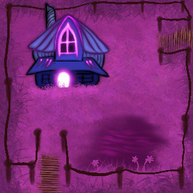

# ICoop — An Adventure for Two

Two characters, fire and water, one keyboard: **ICoop** is a 2D cooperative adventure game developed in **Java 21** for the **2024 EPFL CS-107 project**. Explore rooms, work together to overcome obstacles, and collect the items you need to reach the sanctuary.

This repository contains the game, its Java/Swing engine, and introductory exercises for learning how to use the engine.

<p align="center">
  
  <br>
  <em>Background of Spawn, the starting area.</em>
</p>

[Running the Game](#running-the-game) · [Controls](#controls) · [How to Play](#how-to-play) · [Project Structure](#project-structure)

## The Game

- **Local co-op**: a red character associated with fire and a blue character associated with water, controlled simultaneously on the same keyboard.
- **Exploration and puzzles**: six areas, elemental walls, pressure plates, levers, and passages to unlock.
- **Combat and equipment**: swords, explosives, and elemental staffs, with a separate inventory for each player.
- **Varied enemies**: bomb foes, fire-shooting skulls, and wood monsters.
- **Extensions**: sprinting with a stamina bar, potions, chests, camera effects, waterfalls, and fireworks.
- **Shared camera**: follows both characters and adjusts the view as they move apart.

## Running the Game

### Prerequisites

- **JDK 21** to build and run the project.
- **Maven**, available through the `mvn` command.
- A desktop environment to display the Swing window.

Check your installation:

```sh
java -version
javac -version
mvn -version
```

Maven must use JDK 21. The repository does not include a Maven wrapper, so the `mvn` command requires a local Maven installation.

### From a Terminal

Clone the repository and enter its root directory:

```sh
git clone https://github.com/augustinmonpays/EPFL-Project-ICoop-Game.git
cd EPFL-Project-ICoop-Game
```

Build the game and its engine:

```sh
mvn -pl iccoop -am clean package
```

The `-pl iccoop` option selects the game module; `-am` also builds the engine it depends on. Maven downloads the required plugins during the first build.

Then run the JAR that includes the dependencies:

```sh
java -jar iccoop/target/IC-CoOp-2024-jar-with-dependencies.jar
```

The game window opens. Press **Space** to advance through the welcome dialogue.

To build all modules, including the tutorials:

```sh
mvn clean package
```

### From IntelliJ IDEA

1. Open the root `pom.xml` file as a Maven project.
2. Select **JDK 21** as both the project SDK and the JDK used by Maven.
3. Allow IntelliJ to import all three modules.
4. Run the `main` method in [`ch.epfl.cs107.Play`](iccoop/src/main/java/ch/epfl/cs107/Play.java), in the **`iccoop`** module.

The `tutos` module has its own entry point, `ch.epfl.cs107.play.Play`, which currently launches `Tuto2`.

## Controls

| Action | Red player — fire | Blue player — water |
| --- | --- | --- |
| Move up | `W` | `I` |
| Move left | `A` | `J` |
| Move down | `S` | `K` |
| Move right | `D` | `L` |
| Switch equipped item | `Q` | `U` |
| Use item / interact | `E` | `O` |
| Sprint while moving | Hold `Ctrl` | Hold `Shift` |

| Shared action | Key |
| --- | --- |
| Advance dialogue | `Space` |
| Toggle between the two zoom levels | `C` |
| Restart the current area | `T` |
| Restart the entire game | `R` |

The red player uses **WASD** controls. To adapt the controls to an AZERTY keyboard or your preferences, edit [`KeyBindings.java`](iccoop/src/main/java/ch/epfl/cs107/icoop/KeyBindings.java), then rebuild. The zoom key is defined directly in [`ICoop.java`](iccoop/src/main/java/ch/epfl/cs107/icoop/ICoop.java).

## How to Play

Each player starts with a sword and an explosive. Switch items with `Q` or `U`, then use them with `E` or `O`. To activate a lever or open a chest, face it and press the same action key.

Orbs grant elemental protection that helps you cross hazards. Pressure plates and levers unlock passages: coordinate your movements and keep an eye on both characters.

The sprint bar recharges automatically. Hearts and healing potions restore health, while some other potions trigger camera effects.

When either character runs out of health, the current area restarts for both players. Pressing `T` also triggers this restart and recreates the characters with their starting equipment. Use `R` to restart the game from the beginning.

<details>
<summary><strong>Progression and area objectives — contains puzzle hints</strong></summary>

| Area | Objective |
| --- | --- |
| `Spawn` | Learn the controls and find the entrances to the first challenges. |
| `OrbWay` | Collect both orbs using the pressure plates and elemental passages. |
| `Maze` | Cross the maze and collect both elemental staffs. |
| `Arena` | Collect both keys and take the teleporter back to `Spawn`. |
| `SanctumEntrance` | Fight the wood monsters and activate both levers to open the sanctuary. |
| `Sanctum` | Reach the final area and discover the chests and fireworks. |

The door from `Spawn` to `SanctumEntrance` unlocks once the objectives in `OrbWay`, `Maze`, and `Arena` are complete.

</details>

## Project Structure

```text
.
├── pom.xml                       # Parent Maven project — Java 21
├── game-engine/                  # Game engine and Swing rendering
├── iccoop/                       # ICoop game
│   ├── pom.xml                   # Engine dependency and JAR assembly
│   └── src/main/
│       ├── java/ch/epfl/cs107/
│       │   ├── Play.java         # Game entry point
│       │   └── icoop/
│       │       ├── ICoop.java    # Game loop, transitions, and camera
│       │       ├── KeyBindings.java
│       │       ├── actor/        # Players, enemies, items, and projectiles
│       │       ├── area/         # Main areas and map creation
│       │       ├── handler/      # Interactions, inventory, and dialogue
│       │       └── Extensions/   # Additional mechanics and sanctuary
│       └── resources/
│           ├── dialogs/          # Dialogue in XML format
│           └── images/           # Backgrounds, sprites, and behavior maps
└── tutos/                        # Tuto1 and Tuto2 exercises
```

The module directory is named **`iccoop`**, while the game's Java package is named **`icoop`**.

The engine handles areas, actors, movement on a grid, animations, and interactions. The game uses an **interaction visitor** to define how actors respond to one another, and **logic signals** to connect mechanisms to doors and progression conditions.

To modify the content, useful starting points are the classes in [`area/`](iccoop/src/main/java/ch/epfl/cs107/icoop/area/), the additions in [`Extensions/`](iccoop/src/main/java/ch/epfl/cs107/icoop/Extensions/), and the [game resources](iccoop/src/main/resources/).

## Troubleshooting

| Problem | What to check |
| --- | --- |
| `java`, `javac`, or `mvn` not found | Check that the JDK and Maven are installed and available on your `PATH`. |
| `invalid target release: 21` error | Run `mvn -version` to check that Maven uses JDK 21; fix `JAVA_HOME` if needed. |
| `UnsupportedClassVersionError` | Check that the Java version used to launch the JAR is 21 or later. |
| Missing or non-executable JAR | Build again from the repository root, then use the file ending in `-jar-with-dependencies.jar`. |
| The game waits during dialogue | Press `Space` to read the next line and resume playing. |
| Controls do not respond | Give the game window focus and check the controls configured in `KeyBindings.java`. |
